<p align="center">
  <picture>
    <source media="(prefers-color-scheme: dark)" srcset="assets/banner-dark.svg">
    
  </picture>
</p>

<p align="center">
  <a href="LICENSE"></a>
  <a href="#quick-start"></a>
  <a href="#quick-start"></a>
  <a href="#privacy"></a>
  <a href="#what-it-checks"></a>
  <a href="#use-in-ci"></a>
  <a href="https://github.com/toonight/Airworthy/actions/workflows/ci.yml"></a>
</p>

<p align="center">
  <b>Know what your AI coding agent is allowed to do, before you let it run.</b><br>
  Airworthy reads the configuration around your agent, scores it from 0 to 100 (grade A to F)<br>
  and tells you exactly what to fix. Offline, in one PowerShell command.
</p>

<p align="center">
  🚀 <a href="#quick-start">Quick start</a> ·
  🔎 <a href="#what-it-checks">What it checks</a> ·
  📊 <a href="#report">Report</a> ·
  ⚙️ <a href="#use-in-ci">CI</a> ·
  🤝 <a href="#contributing">Contributing</a> ·
  🛡️ <a href="#security">Security</a>
</p>

---

## About

AI coding agents such as GitHub Copilot in VS Code, Claude Code, Copilot CLI and Codex CLI do what
their **harness** lets them do. The harness is the configuration around the model: tool approvals,
terminal allow rules, the sandbox, network access, MCP servers, custom agents, instruction and
prompt files, and hooks. It is spread across a dozen files in the repository and in your user
profile, each with its own precedence rules. One `"chat.tools.global.autoApprove": true`, one
`Bash(*)` allow rule, one `sandbox_mode = "danger-full-access"` or one unpinned `npx` MCP server
is enough to turn a prompt injection into code execution on your machine.

**Airworthy** is an offline static analyzer for these *custom* harness configurations. It finds
the files, works out the settings that actually apply, runs 85 security rules and reports a
score, a grade, and each finding with its evidence and a concrete fix, as console text, JSON,
SARIF 2.1.0, Markdown or a self-contained HTML report. The name is the question it answers: is
this agent setup worthy of being trusted to run?

It is built for:

- **developers** who want to know what their agent may do without asking, before they let it run;
- **security and platform teams** who review or standardize agent configurations across repositories;
- **maintainers and reviewers** of repositories that ship `.vscode/`, `.claude/`, `.codex/`, `.github/agents/` or `.mcp.json` files;
- **CI pipelines** that should fail, or raise code scanning alerts, when a risky agent setting lands.

## Why Airworthy?

<table>
  <tr>
    <td width="33%" valign="top">
      <h3>📴 Offline, zero dependency</h3>
      No network call, no telemetry, no module or binary to download. Airworthy reads
      configuration files and never runs an agent, an MCP server or a hook.
    </td>
    <td width="33%" valign="top">
      <h3>🪟 Windows-native PowerShell</h3>
      Runs on the Windows PowerShell 5.1 that ships with Windows 10 and 11. No installer,
      no admin rights: clone or download, then run one script.
    </td>
    <td width="33%" valign="top">
      <h3>🧭 Effective permissions</h3>
      Resolves what actually applies, layer by layer: Claude Code managed policy &gt; local &gt;
      project &gt; user; VS Code default &lt; user &lt; workspace file &lt; workspace; Codex
      project &gt; profile &gt; user config, within the limits of <code>requirements.toml</code>; and the
      tools of a prompt file over those of its custom agent.
    </td>
  </tr>
  <tr>
    <td width="33%" valign="top">
      <h3>🔒 A safe HTML report</h3>
      One self-contained file. Scanned values are embedded as inert JSON and rendered as text
      only, under a strict Content-Security-Policy that blocks every network load.
    </td>
    <td width="33%" valign="top">
      <h3>🧩 SARIF for code scanning</h3>
      SARIF 2.1.0 with <code>security-severity</code>, precision, rule help and tags, ready for
      GitHub code scanning. <code>-FailOn</code> sets the exit code for CI gates.
    </td>
    <td width="33%" valign="top">
      <h3>🛡️ Antivirus-friendly by design</h3>
      ASCII-only scripts, no encoded commands, no dynamic code execution, no download code.
      Risky command names live as plain data tokens in JSON files.
    </td>
  </tr>
</table>

## Quick start

```powershell
# 1. Get Airworthy: clone it, or download the ZIP from GitHub and extract it
git clone https://github.com/toonight/Airworthy.git C:\tools\Airworthy

# 2. ZIP download only: once you have reviewed the files, remove the "downloaded from the internet" mark
Get-ChildItem -Path C:\tools\Airworthy -Recurse -File |
    Where-Object { $_.Extension -in '.ps1', '.psm1', '.psd1' } |
    Unblock-File

# 3. Go to the project you want to check, and score it in the console
cd C:\src\my-project
C:\tools\Airworthy\airworthy.ps1 -Path .

# 4. Write the self-contained HTML report, .\airworthy-report.html
C:\tools\Airworthy\airworthy.ps1 -Path . -Format Html -OutFile .\airworthy-report
```

`-Path` is the folder to analyze, and `.` is the current folder. If you run Airworthy from its own
folder instead, give the project folder as the path:
`.\airworthy.ps1 -Path C:\src\my-project -Format Html -OutFile .\airworthy-report`.

<details>
<summary><b>Sample console output</b> (the <code>insecure</code> test fixture, with <code>-NoUserProfile -Redact</code>)</summary>

```text
Airworthy 0.2.0  agent harness security score
  Root       insecure
  Harnesses  vscode-copilot, claude-code, codex, mcp
  Score      14/100  grade F
  Findings   7 critical, 21 high, 13 medium, 5 low, 2 info

Categories
  Approvals and terminal        [--------------------]   0  18 findings
  Sandbox and network           [--------------------]   0  8 findings
  MCP and supply chain          [##------------------]  10  10 findings
  Agent files and instructions  [#########-----------]  44  5 findings
  Secrets                       [--------------------]   0  7 findings
  Audit and observability       [####################] 100

Findings
  CRITICAL (7)
    AW-CC-003  Every shell command is pre-approved
        .claude\settings.json:5
        Evidence: permissions.allow contains 'Bash(*)' in project settings: every Bash command runs without approval
        Fix: Replace broad rules with exact commands or narrow prefixes, for example "Bash(npm run test *)" and "Bash(git status)", ...
    AW-CDX-002  Codex never asks for approval
        .codex\config.toml:5
        Evidence: approval_policy = "never" (project config); with sandbox_mode = "danger-full-access" (project config): no sandbox and no approval
        Fix: Use approval_policy = "on-request" (or a granular table that keeps the prompts you need), ...
    ...
```

</details>

> [!TIP]
> If PowerShell answers that running scripts is disabled on this system, the execution policy
> is `Restricted`, the default on Windows client editions. Ask your administrator, or allow local
> scripts for your own account with `Set-ExecutionPolicy -Scope CurrentUser -ExecutionPolicy RemoteSigned`.
> Airworthy never needs a policy bypass.

### Options

| Option | What it does |
| --- | --- |
| `-Path <folder>` | Folder to analyze. Default: the current folder. |
| `-Format <list>` | One or more of `Console` (default), `Json`, `Sarif`, `Markdown`, `Html`. `"Json,Sarif"` also works. |
| `-OutFile <base>` | Base file name without extension: writes `<base>.json`, `.sarif`, `.md` and `.html` for the requested formats. Without it, those formats go to the pipeline. |
| `-NoUserProfile` | Read nothing from the user profile or machine-wide locations: analyze `-Path` only. |
| `-UserProfilePath <folder>` | Use this folder as the user profile instead of the real one. |
| `-UserSettingsPath <file>` | Use this VS Code user `settings.json` instead of the one in the profile. |
| `-Redact` | Show the analyzed folder by its name only, replace the profile with `~` and mask the user name, in every output. Use it for reports you share. |
| `-MinSeverity <sev>` | Report only findings at or above `critical`, `high`, `medium`, `low` or `info` (default). The score always uses every finding. |
| `-FailOn <sev>` | Exit with code 1 when a finding at or above this severity exists, hidden ones included. |
| `-PassThru` | Also return the result object. |
| `-Quiet` | Do not print the console report. |

Exit codes: **0** the analysis ran and nothing reached `-FailOn` (or `-FailOn` was not given),
**1** at least one finding reached `-FailOn`, **2** the analysis could not run (for example the
path is not a folder or an option is invalid).

### Use it as a module

```powershell
Import-Module C:\tools\Airworthy\Airworthy.psd1
$result = Invoke-Airworthy -Path . -NoUserProfile -PassThru -Quiet
$result.Score.Score, $result.Score.Grade
$result.Findings | Where-Object Severity -eq 'critical' | Format-Table RuleId, Title
```

`Invoke-Airworthy` takes the same parameters as the script and is the only exported command.
Pass several formats as a list (`-Format Json, Sarif`).

## What it checks

Airworthy analyzes five harness families, plus files any agent reads. It looks only at the
locations below, not at the whole repository tree.

| Harness | In the analyzed folder | In the user profile (skipped with `-NoUserProfile`) |
| --- | --- | --- |
| **VS Code GitHub Copilot** (custom agents and agent mode) | `.vscode/settings.json`, `*.code-workspace`, `.vscode/mcp.json`, `.github/agents/*.agent.md`, `.github/chatmodes/*.chatmode.md`, `.github/copilot-instructions.md`, `.github/instructions/*.instructions.md`, `.github/prompts/*.prompt.md`, `.github/hooks/*.json` | VS Code and VS Code Insiders `User/settings.json` and `User/mcp.json` |
| **Claude Code** | `.claude/settings.json`, `.claude/settings.local.json`, `.claude/agents/*.md`, `CLAUDE.md`, `.mcp.json` | `~/.claude/settings.json`, the MCP servers of `~/.claude.json`, and the machine-wide `managed-settings.json` when present |
| **Copilot CLI** | `.github/copilot/settings.json`, `.github/copilot/settings.local.json`, `.github/mcp.json` | `~/.copilot/config.json`, `~/.copilot/settings.json`, `~/.copilot/mcp-config.json`, `~/.copilot/agents/*.agent.md`, `~/.copilot/hooks/*.json` |
| **Codex CLI** | `.codex/config.toml` (with its MCP servers and hooks), `.codex/hooks.json`, `.codex/rules/*.rules` | `~/.codex/config.toml` and, when `CODEX_HOME` is set, `$CODEX_HOME/config.toml`; the profile files `<name>.config.toml` of those folders; the machine-wide `requirements.toml` when present |
| **Any agent** | `AGENTS.md`, and `.env*` files at the root (secret scan) | |

The rules fall into six weighted categories. The severities below are rule defaults: some rules
raise or lower the severity of a finding from its context (for example `AW-VSC-003` becomes
critical on Windows when the agent sandbox is not on).

### Approvals and terminal (weight 25, 20 rules)

| Severity | What Airworthy flags | Rules |
| --- | --- | --- |
|  | Global tool auto-approval in VS Code, a catch-all terminal allow rule, Claude Code starting in `bypassPermissions` mode, an allow rule that pre-approves every shell command | `AW-VSC-001` `AW-VSC-004` `AW-CC-001` `AW-CC-003` |
|  | A default permission level that skips approvals, terminal auto-approval, risky commands (downloaders, inline interpreters, `git push`, `rm -rf`) auto-approved, built-in approval rules ignored, edit auto-approval over agent control files, Copilot CLI or Codex trusting a drive root or the home folder, Codex MCP tools that run without a prompt | `AW-VSC-002` `AW-VSC-003` `AW-VSC-005` `AW-VSC-007` `AW-VSC-009` `AW-CLI-001` `AW-CDX-008` `AW-CDX-010` |
|  | Claude Code starting in a mode that auto-approves edits, Windows download and exfiltration commands without approval-required rules, terminal prompts answered automatically, Codex never asking for approval (critical when its sandbox is off too) | `AW-CC-002` `AW-VSC-006` `AW-VSC-008` `AW-CDX-002` |
|  | Terminal risk assessment turned off, an agent request limit above 100 | `AW-VSC-011` `AW-VSC-020` |
|  | Claude Code bypass mode and Copilot CLI allow-all mode not disabled | `AW-CC-010` `AW-CLI-005` |

### Sandbox and network (weight 20, 22 rules)

| Severity | What Airworthy flags | Rules |
| --- | --- | --- |
|  | A remote MCP server over cleartext `http://` or `ws://`, an MCP container that breaks its isolation (`--privileged`, host network, `SYS_ADMIN`, mounts of the home folder or the Docker socket), wildcard URL auto-approval, the agent sandbox turned off, sandboxed commands auto-approved with open network, the Codex sandbox turned off (`danger-full-access`), Codex write access to the home folder or a drive root | `AW-MCP-003` `AW-MCP-005` `AW-VSC-010` `AW-VSC-012` `AW-VSC-018` `AW-CDX-001` `AW-CDX-005` |
|  | Web fetches to any domain pre-approved, project settings that weaken the Claude Code sandbox, Copilot CLI allowing every URL, unrestricted egress, commands allowed to leave the sandbox, developer-tool access and Git or GitHub CLI credentials inside the sandbox, credential folders (`~/.ssh`, `~/.aws`, `~/.azure`) not denied, read access outside the workspace, network access in the Codex `workspace-write` sandbox, Codex permission profiles with unrestricted network, the `dangerously_*` options of the Codex network proxy, Codex live web search, Codex profiles that weaken the sandbox or the approvals | `AW-CC-004` `AW-CC-008` `AW-CLI-002` `AW-VSC-013` `AW-VSC-014` `AW-VSC-015` `AW-VSC-016` `AW-VSC-017` `AW-VSC-019` `AW-CDX-003` `AW-CDX-004` `AW-CDX-006` `AW-CDX-011` `AW-CDX-014` |
|  | Claude Code sandboxed commands that can still run outside the sandbox | `AW-CC-009` |

### MCP and supply chain (weight 20, 13 rules)

| Severity | What Airworthy flags | Rules |
| --- | --- | --- |
|  | Every project MCP server approved automatically, MCP servers launched without a pinned version (`npx`, `uvx`, `pipx run`, `docker run` without a tag or digest), Workspace Trust turned off | `AW-CC-006` `AW-MCP-001` `AW-VSC-026` |
|  | Repository settings that run commands (Claude Code hooks and helpers, Copilot CLI hooks, VS Code hook files, Codex hooks), Codex rules that allow commands outside the sandbox, MCP servers launched with inline shell or interpreter code, MCP discovery from other applications, servers pre-authorized for sampling | `AW-CC-007` `AW-CLI-003` `AW-VSC-027` `AW-CDX-012` `AW-CDX-013` `AW-MCP-004` `AW-VSC-021` `AW-VSC-023` |
|  | MCP servers that start automatically | `AW-VSC-022` |
|  | More than 10 MCP servers configured | `AW-MCP-006` |

### Agent files and instructions (weight 15, 13 rules)

| Severity | What Airworthy flags | Rules |
| --- | --- | --- |
|  | A custom agent with `tools: '*'`, a hidden instruction in an HTML comment, invisible or bidirectional control characters, Unicode tag characters that smuggle hidden text | `AW-AGT-001` `AW-AGT-008` `AW-AGT-009` `AW-AGT-010` |
|  | Every tool of an MCP server enabled, no tools list, `agents: '*'`, handoffs with `send: true`, a prompt file that grants tools beyond its agent's list, instructions that tell the agent not to ask for approval | `AW-AGT-002` `AW-AGT-003` `AW-AGT-004` `AW-AGT-005` `AW-AGT-006` `AW-AGT-007` |
|  | Instructions that point to private or internal URLs | `AW-AGT-011` |
|  | Agent model not pinned, agent frontmatter hooks that run only in the Local harness | `AW-AGT-012` `AW-AGT-013` |

### Secrets (weight 15, 16 rules)

| Severity | What Airworthy flags | Rules |
| --- | --- | --- |
|  | A literal secret in an MCP server configuration (env, headers, arguments, command or URL) | `AW-MCP-002` |
|  | GitHub tokens, AWS access key IDs, Azure Storage account keys, OpenAI-style and Anthropic API keys, Slack tokens and private keys in configuration or instruction files, a client secret or bearer token stored in a Codex config file (critical in the project file) | `AW-SEC-001` to `AW-SEC-007` `AW-CDX-009` |
|  | JSON Web Tokens, hard-coded password, secret or token values, prompt content captured in telemetry, Copilot CLI allowed to store tokens in plain text | `AW-SEC-008` `AW-SEC-009` `AW-VSC-025` `AW-CLI-004` |
|  | No Claude Code deny rule for `.env` files and `~/.ssh`, an environment file at the root of the workspace, Codex passing every environment variable, secrets included, to commands | `AW-CC-005` `AW-SEC-010` `AW-CDX-007` |

### Audit and observability (weight 5, 1 rule)

| Severity | What Airworthy flags | Rules |
| --- | --- | --- |
|  | Agent OpenTelemetry traces turned off, so there is no local audit trail | `AW-VSC-024` |
|  | Engine findings: a file that could not be read or parsed, or a rule that failed (they never change the score) | `AW-CORE-001` `AW-CORE-002` |

Every rule carries a description, a concrete fix, an [OWASP Top 10 for Agentic Applications](https://genai.owasp.org)
reference and, for all but one rule, a link to the official Microsoft, GitHub, Anthropic or OpenAI
documentation. Each rule also has a **confidence**: `high` when the documented behavior is
confirmed, `medium` when the documentation is incomplete or contradictory, in which case the
description says what remains to be verified. Today 61 rules have `high` confidence and 24 have `medium`.

<details>
<summary><b>All 85 rules</b> (generated from the module's rule registry)</summary>

<br>

| ID | Severity | Title | Harness |
| --- | --- | --- | --- |
| `AW-AGT-001` | high | Custom agent enables every tool (tools: '\*') | Any |
| `AW-AGT-002` | medium | Custom agent enables every tool of an MCP server ('&lt;server&gt;/\*') | Any |
| `AW-AGT-003` | medium | Custom agent without a tools list (all tools enabled) | Any |
| `AW-AGT-004` | medium | Custom agent can call any agent as a subagent (agents: '\*') | VS Code Copilot |
| `AW-AGT-005` | medium | Handoff submits its prompt automatically (send: true) | VS Code Copilot |
| `AW-AGT-006` | medium | Prompt file grants tools beyond its agent's list | VS Code Copilot |
| `AW-AGT-007` | medium | Instructions tell the agent not to ask for approval | Any |
| `AW-AGT-008` | high | Hidden instruction in an HTML comment | Any |
| `AW-AGT-009` | high | Invisible or bidirectional control characters in an agent file | Any |
| `AW-AGT-010` | high | Unicode tag characters hide text in an agent file | Any |
| `AW-AGT-011` | low | Instructions point to private or internal URLs | Any |
| `AW-AGT-012` | info | Custom agent model not pinned | Any |
| `AW-AGT-013` | info | Agent frontmatter hooks run only in the Local harness | VS Code Copilot |
| `AW-CC-001` | critical | Claude Code starts in bypassPermissions mode | Claude Code |
| `AW-CC-002` | medium | Claude Code starts in a mode that auto-approves actions | Claude Code |
| `AW-CC-003` | critical | Every shell command is pre-approved | Claude Code |
| `AW-CC-004` | medium | Web fetches to any domain are pre-approved | Claude Code |
| `AW-CC-005` | low | No deny rule protects secret files | Claude Code |
| `AW-CC-006` | high | Every project MCP server is approved automatically | Claude Code |
| `AW-CC-007` | medium | Project settings run commands (hooks or helpers) | Claude Code |
| `AW-CC-008` | medium | Project settings disable or weaken the sandbox | Claude Code |
| `AW-CC-009` | low | Sandboxed commands can still run outside the sandbox | Claude Code |
| `AW-CC-010` | info | bypassPermissions mode is not disabled | Claude Code |
| `AW-CDX-001` | high | Codex runs commands without a sandbox | Codex CLI |
| `AW-CDX-002` | medium | Codex never asks for approval | Codex CLI |
| `AW-CDX-003` | medium | Codex workspace-write sandbox has network access | Codex CLI |
| `AW-CDX-004` | medium | Codex permission profile allows unrestricted network access | Codex CLI |
| `AW-CDX-005` | high | Codex can write to a very broad folder | Codex CLI |
| `AW-CDX-006` | medium | Codex network proxy safety check turned off | Codex CLI |
| `AW-CDX-007` | low | Codex passes every environment variable, secrets included, to commands | Codex CLI |
| `AW-CDX-008` | high | Codex MCP tools run without approval | Codex CLI |
| `AW-CDX-009` | high | Secret stored in a Codex config file | Codex CLI |
| `AW-CDX-010` | high | Codex trusts a folder that is too broad | Codex CLI |
| `AW-CDX-011` | medium | Codex live web search is enabled | Codex CLI |
| `AW-CDX-012` | medium | Project Codex hooks run commands | Codex CLI |
| `AW-CDX-013` | medium | Project Codex rules allow commands outside the sandbox | Codex CLI |
| `AW-CDX-014` | medium | Codex profile weakens the sandbox or the approvals | Codex CLI |
| `AW-CLI-001` | high | Copilot CLI trusts a folder that is too broad | Copilot CLI |
| `AW-CLI-002` | medium | Copilot CLI allows every URL without prompting | Copilot CLI |
| `AW-CLI-003` | medium | Repository settings run Copilot CLI hooks | Copilot CLI |
| `AW-CLI-004` | medium | Copilot CLI may store tokens in plain text | Copilot CLI |
| `AW-CLI-005` | info | Copilot CLI allow-all mode is not disabled | Copilot CLI |
| `AW-MCP-001` | high | MCP server launched without a pinned version | MCP (all clients) |
| `AW-MCP-002` | critical | Hardcoded secret in an MCP server configuration | MCP (all clients) |
| `AW-MCP-003` | high | Remote MCP server reached over cleartext HTTP | MCP (all clients) |
| `AW-MCP-004` | medium | MCP server runs inline shell or interpreter code | MCP (all clients) |
| `AW-MCP-005` | high | MCP server container breaks out of its isolation | MCP (all clients) |
| `AW-MCP-006` | info | Large number of MCP servers | MCP (all clients) |
| `AW-SEC-001` | high | GitHub token in a configuration file | Any |
| `AW-SEC-002` | high | AWS access key ID in a configuration file | Any |
| `AW-SEC-003` | high | Azure Storage account key in a connection string | Any |
| `AW-SEC-004` | high | OpenAI-style API key in a configuration file | Any |
| `AW-SEC-005` | high | Anthropic API key in a configuration file | Any |
| `AW-SEC-006` | high | Slack token in a configuration file | Any |
| `AW-SEC-007` | high | Private key in a configuration file | Any |
| `AW-SEC-008` | medium | JSON Web Token in a configuration file | Any |
| `AW-SEC-009` | medium | Hard-coded password, secret or token value | Any |
| `AW-SEC-010` | low | Environment file in the workspace | Any |
| `AW-VSC-001` | critical | Global auto-approval of tools enabled | VS Code Copilot |
| `AW-VSC-002` | high | Default permission level skips approvals | VS Code Copilot |
| `AW-VSC-003` | high | Terminal command auto-approval enabled | VS Code Copilot |
| `AW-VSC-004` | critical | Catch-all or broad terminal allow rule | VS Code Copilot |
| `AW-VSC-005` | high | Risky command auto-approved in the terminal | VS Code Copilot |
| `AW-VSC-006` | medium | Windows exfiltration commands lack approval-required rules | VS Code Copilot |
| `AW-VSC-007` | high | Built-in terminal approval rules ignored | VS Code Copilot |
| `AW-VSC-008` | medium | Terminal prompts answered automatically | VS Code Copilot |
| `AW-VSC-009` | high | Edit auto-approval covers agent control files | VS Code Copilot |
| `AW-VSC-010` | high | Wildcard URL auto-approval | VS Code Copilot |
| `AW-VSC-011` | low | Terminal risk assessment disabled | VS Code Copilot |
| `AW-VSC-012` | high | Agent sandbox disabled | VS Code Copilot |
| `AW-VSC-013` | medium | Unrestricted network egress | VS Code Copilot |
| `AW-VSC-014` | medium | Commands may leave the sandbox | VS Code Copilot |
| `AW-VSC-015` | medium | Sandbox grants developer-tool access | VS Code Copilot |
| `AW-VSC-016` | medium | Credentials injected into the sandbox | VS Code Copilot |
| `AW-VSC-017` | medium | Credential folders not denied in the sandbox | VS Code Copilot |
| `AW-VSC-018` | high | Sandboxed commands auto-approved with open network | VS Code Copilot |
| `AW-VSC-019` | medium | Read access outside the workspace | VS Code Copilot |
| `AW-VSC-020` | low | High agent request limit | VS Code Copilot |
| `AW-VSC-021` | medium | MCP server discovery from other applications | VS Code Copilot |
| `AW-VSC-022` | low | MCP servers start automatically | VS Code Copilot |
| `AW-VSC-023` | medium | MCP server pre-authorized for sampling | VS Code Copilot |
| `AW-VSC-024` | low | Agent OpenTelemetry disabled | VS Code Copilot |
| `AW-VSC-025` | medium | Prompt content captured in telemetry | VS Code Copilot |
| `AW-VSC-026` | high | Workspace Trust disabled | VS Code Copilot |
| `AW-VSC-027` | medium | Repository hook file runs in the Local harness | VS Code Copilot |

*Any* rules apply whatever harness is detected. *MCP (all clients)* rules apply to the MCP
servers of VS Code, Claude Code, Copilot CLI and Codex CLI alike. To list the rules yourself:
`& (Import-Module .\Airworthy.psd1 -PassThru) { Get-AwRules } | Format-Table Id, Severity, Harness, Title`.

</details>

### Codex CLI

Codex CLI keeps its configuration in TOML files. Airworthy reads them with its own TOML parser,
with no dependency and the same guards as its other parsers (a size limit, a depth limit and a
linear tokenizer): an invalid or hostile file becomes an `AW-CORE-001` finding. The project
`.codex/config.toml` overrides the user `config.toml`, and each profile file (`<name>.config.toml`,
selected with `--profile <name>`) is checked with the layers it applies with: project config >
profile > user config. As in Codex, `sandbox_mode` in any loaded file takes precedence over
`default_permissions`, and `[sandbox_workspace_write]` does not apply with permission profiles.
The 14 `AW-CDX` rules cover:

- **Sandbox, approvals and trust:** the sandbox turned off with `sandbox_mode = "danger-full-access"`
  or `default_permissions = ":danger-full-access"` (`AW-CDX-001`); `approval_policy = "never"`,
  critical when the sandbox is off too, as with `--yolo` (`AW-CDX-002`); `trust_level = "trusted"`
  on the home folder or a drive root (`AW-CDX-010`); profiles that weaken the sandbox or the
  approvals, high when the profile and the user or project config together leave neither
  (`AW-CDX-014`).
- **Network and file system:** network access in the `workspace-write` sandbox (`AW-CDX-003`),
  permission profiles with the network on but the network proxy off (direct, unrestricted
  access), full network access or a `"*" = "allow"` domain rule (`AW-CDX-004`),
  writable roots such as the home folder or a drive root (`AW-CDX-005`), the `dangerously_*`
  options of the network proxy (`AW-CDX-006`) and live web search (`AW-CDX-011`).
- **Secrets:** every environment variable passed to commands with
  `shell_environment_policy.inherit = "all"` and no filter (`AW-CDX-007`), and a literal
  `oauth.client_secret` or `experimental_bearer_token` (`AW-CDX-009`, critical in the project file).
- **MCP servers, hooks and rules:** MCP servers and tools set to run without a prompt
  (`AW-CDX-008`), project hooks (`AW-CDX-012`) and project rules that allow commands outside the
  sandbox (`AW-CDX-013`). The `[mcp_servers.<id>]` tables also go through the `AW-MCP` rules:
  unpinned launchers, literal secrets in `env` or `http_headers`, cleartext HTTP, inline code and
  container escapes. `env_http_headers`, `bearer_token_env_var` and `env_vars` name environment
  variables, so their values are not reported as secrets.

When the machine-wide `requirements.toml` does not allow a value (`allowed_sandbox_modes`,
`allowed_approval_policies`, `allowed_web_search_modes` or `allowed_permission_profiles`), the
matching finding drops to `info`, and project hooks are not reported when it allows managed hooks
only. Command-line flags such as `--yolo`, `--sandbox` or `-c key=value` are invisible to a static
analysis.

## Scoring

Each finding removes points from its category, according to its severity:

| Severity |  |  |  |  |  |
| --- | :---: | :---: | :---: | :---: | :---: |
| **Weight** | 40 | 20 | 8 | 3 | 0 |

1. **Per rule.** The first (heaviest) finding of a rule removes its full weight, and every
   further finding of the same rule removes 25% of its own weight. The deduction of one rule is
   **capped at twice** the weight of its first finding, so one noisy rule cannot sink the score
   on its own.
2. **Per category.** Each category starts at 100 and never goes below 0.
3. **Overall.** The overall score is the weighted average of the categories that apply
   (approvals 25, sandbox and network 20, MCP and supply chain 20, agent files 15, secrets 15,
   observability 5). A category applies when at least one of its rules targets a detected harness,
   or any harness.
4. **Critical cap.** If any finding is critical, the overall score is **capped at 69**: a
   configuration with a critical issue can never get better than a D.
5. **Grade.**

| Grade |  |  |  |  |  |
| --- | :---: | :---: | :---: | :---: | :---: |
| **Score** | 90 or more | 80 to 89 | 70 to 79 | 60 to 69 | below 60 |

`-MinSeverity` only hides findings from the report: the score always counts every finding.
The same input always gives the same output, apart from the scan timestamp.

## Report

`-Format Html` writes a single, self-contained HTML file that opens offline in any modern browser:

- a score gauge with the grade, a verdict and the critical cap when it applies;
- the score of each category, with its share of the overall score and its number of findings;
- severity chips, a search box (press <kbd>/</kbd>), category and harness filters, and sorting by severity, rule or file;
- expandable findings with the location, the evidence (secrets masked), the fix, the reasoning and the references;
- the table of every rule evaluated, with its result;
- light and dark themes, print styles, keyboard navigation and screen reader labels.

**See it:** [`examples/airworthy-insecure.html`](examples/airworthy-insecure.html) (score 14, grade F) and
[`examples/airworthy-hardened.html`](examples/airworthy-hardened.html) (score 98, grade A), generated from the
test fixtures. GitHub shows the source of HTML files: download the file and open it in your browser.
The same analysis is also available as [Markdown](examples/airworthy-insecure.md),
[SARIF](examples/airworthy-insecure.sarif) and [JSON](examples/airworthy-insecure.json).

> [!NOTE]
> The report treats every scanned value as hostile. The results are embedded as inert JSON with
> every character that could close the element escaped, the page builds its content with
> `textContent` only and shows invisible characters as `[U+XXXX]`, and a Content-Security-Policy
> with SHA-256 hashes allows only its own script and stylesheet, with `default-src 'none'`.
> Links are created only for `https` references on an allowlist of documentation hosts.

## Use in CI

Run Airworthy on a Windows runner, fail the job on high or critical findings, and send the SARIF
file to GitHub code scanning so that findings show up as alerts on the lines that cause them:

```yaml
# .github/workflows/airworthy.yml
name: Airworthy

on:
  push:
    branches: [main]
  pull_request:

permissions:
  contents: read

jobs:
  airworthy:
    runs-on: windows-latest
    permissions:
      contents: read
      security-events: write
    steps:
      - name: Check out the repository
        uses: actions/checkout@3d3c42e5aac5ba805825da76410c181273ba90b1 # v7.0.1
        with:
          persist-credentials: false

      - name: Check out Airworthy
        uses: actions/checkout@3d3c42e5aac5ba805825da76410c181273ba90b1 # v7.0.1
        with:
          repository: toonight/Airworthy
          ref: main # better: a commit SHA or release tag you have reviewed
          path: .airworthy
          persist-credentials: false

      - name: Run Airworthy
        shell: powershell
        run: powershell -NoProfile -File .\.airworthy\airworthy.ps1 -Path . -NoUserProfile -Format Console,Sarif -OutFile airworthy -FailOn high

      - name: Upload the SARIF file to code scanning
        if: always() && hashFiles('airworthy.sarif') != ''
        uses: github/codeql-action/upload-sarif@6f2ac81f5cd81fe351a197ba0b00d91d03cd2aee # v4.39.0
        with:
          sarif_file: airworthy.sarif
          category: airworthy
```

- `shell: powershell` runs Windows PowerShell 5.1, the reference engine.
- `-NoUserProfile` keeps the analysis on the repository: the runner's own profile is irrelevant.
- `-FailOn high` fails the job on high and critical findings. Use `critical` for a softer gate,
  or drop it to report only. The upload step still runs when the gate fails.
- Paths in the SARIF file are relative to the repository root, so alerts point to the right file and line.

> [!WARNING]
> Pin both actions to a full commit SHA, as above, and pin Airworthy itself to a commit you have
> reviewed. Uploading SARIF needs code scanning on the repository and the `security-events: write`
> permission, which pull requests from forks do not get.

## Privacy

- **100% offline.** No network call, no telemetry, no update check. The HTML report loads
  nothing either: it only stores your light or dark theme choice in the browser.
- **Limited reads.** With `-NoUserProfile`, Airworthy reads only the analyzed folder (plus the
  `-UserSettingsPath` file, if you name one). By default it
  also reads the agent configuration files of your user profile listed in
  [What it checks](#what-it-checks), and the machine-wide Claude Code `managed-settings.json` and
  Codex `requirements.toml` if there are any. It never follows a symbolic link or junction out of the analyzed folder, and it
  writes nothing but the `-OutFile` reports you ask for.
- **Masked secrets.** Secrets are never shown in full in any output: they keep their first 4 and
  last 2 characters and their length (`ghp_…34 (40 chars)`).
- **`-Redact` for shared reports.** The analyzed folder appears by its name only, the profile
  becomes `~` and your user name becomes `%USERNAME%`, in paths, evidence and options, in every
  format. The SARIF file then has no absolute base URI.

> [!WARNING]
> `-Redact` masks the analyzed folder, the user profile and the user name. Other absolute paths,
> such as a `-UserSettingsPath` file elsewhere, the machine-wide `managed-settings.json` and
> `requirements.toml`, or the project paths listed in `~/.claude.json`, stay as they are (in SARIF,
> as `file:///` URIs).
> Review a report before you share it.

## Limitations

- **Static analysis only.** Airworthy reads files. It cannot see command-line flags, permissions
  granted during a session, or policies held elsewhere: GitHub organization and enterprise policies,
  VS Code policies deployed through the registry, Copilot CLI managed settings, or the Codex
  `managed_config.toml` and `/etc/codex/config.toml` layers. Claude Code managed settings and the
  Codex `requirements.toml` are read only from the real machine.
- **A fast-moving target.** The rules follow the official documentation of each harness as read in
  October 2026. Harnesses change quickly, and 24 rules have `medium` confidence because the
  documentation is incomplete or contradictory.
- **Heuristics.** The secret and instruction-text checks can produce false positives and miss
  things. The secret scan covers the discovered configuration files and the root `.env*` files: it
  does not replace a repository-wide secret scanner.
- **Scope.** Only the known locations above are read: nested `AGENTS.md` files, `.codex/` folders
  of sub-folders, personal Codex hooks and rules (`~/.codex/hooks.json`, `~/.codex/rules/`) and
  sub-projects of a monorepo are not discovered. Files over 2 MB are skipped, each analysis reads at most 32 MB,
  and a file that cannot be read becomes an `AW-CORE-001` finding.
- **Regex dialect.** VS Code terminal rules are JavaScript regexes; Airworthy evaluates them with
  .NET regexes under a short timeout, so a JavaScript-only feature makes a rule count as non-matching.
- **Platforms.** Windows PowerShell 5.1 is the reference target. The CI workflow also runs the
  test suite on PowerShell 7 on Windows. macOS and Linux are design targets that have not been
  verified yet.
- **Not a guarantee.** A good grade means Airworthy found no known risky setting, not that the agent is safe.

## Roadmap

Ideas for the next versions, in no particular order. Feedback and pull requests are welcome.

- [ ] **Packaging:** a PowerShell Gallery module and a ready-made GitHub Action.
- [ ] **More harnesses:** Cursor, Windsurf and Gemini CLI.
- [ ] **Enterprise policies:** read VS Code policies from the Windows registry, and GitHub managed settings.
- [ ] **Baselines:** compare two analyses, track the score over time, and accept known findings.
- [ ] **More rules:** the Copilot CLI sandbox setting, `headersHelper` in `.mcp.json`, and the `env` block of Claude Code settings.
- [ ] **SARIF:** `partialFingerprints` for direct uploads to the code scanning API.
- [ ] **Platforms:** verify PowerShell 7 on Windows, macOS and Linux.
- [ ] **Hygiene in the suite:** run the antivirus-hygiene check from the test suite, with its patterns in a data file.
- [ ] **Canary checks (opt-in):** benign, sandboxed probes that confirm a setting really blocks an action.

## Contributing

Contributions are welcome: new rules, better fixes, fixture cases, harness support and
documentation. Start with [CONTRIBUTING.md](CONTRIBUTING.md) for the development setup, the
PowerShell 5.1 rules, the antivirus-hygiene rules and how to add a rule with its tests. The design
is described in [docs/ARCHITECTURE.md](docs/ARCHITECTURE.md), and the changes in
[CHANGELOG.md](CHANGELOG.md).

```powershell
powershell -NoProfile -File .\tests\Run-Tests.ps1                # full suite
powershell -NoProfile -File .\tests\Run-Tests.ps1 -Name VSCode   # one area
```

## Security

Airworthy is a security tool that reads hostile input by design. If you find a way to make it
run code, leak a secret, read outside the analyzed folder, hang, or inject content into a report,
please report it privately as described in [SECURITY.md](SECURITY.md). Do not open a public issue.

## License

Airworthy is licensed under the [Apache License 2.0](LICENSE). See [NOTICE](NOTICE).

Copyright 2026 Toonight.

## Disclaimer

Airworthy is an independent project. It is not affiliated with, endorsed by or sponsored by
Microsoft, GitHub, Anthropic, OpenAI or Harness Inc. Visual Studio Code, GitHub Copilot, Claude
Code, Codex and the other product names are trademarks of their respective owners and are used only to describe
compatibility. Airworthy performs a best-effort static analysis: it does not guarantee that a
configuration is secure, and it is provided "as is", without warranty of any kind.
